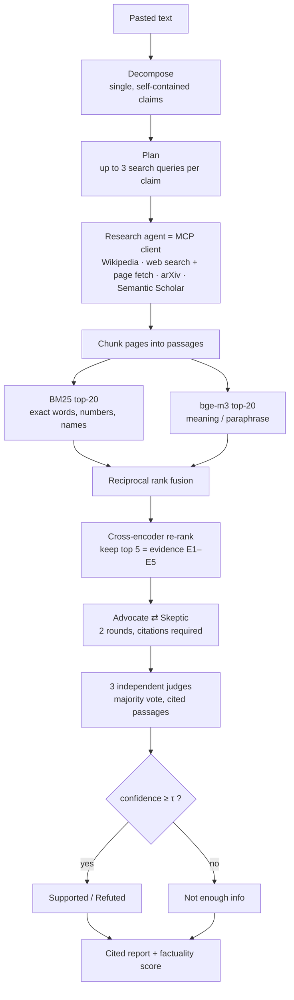
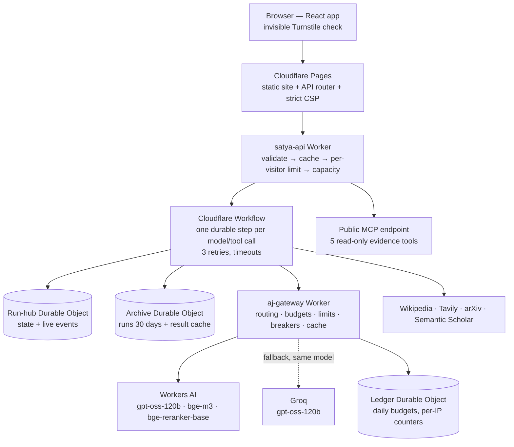

# Satya — project documentation

**Satya** (सत्य, "truth") is a multi-agent fact-verification system. It splits a text into single factual claims, gathers evidence through MCP tools, lets an advocate and a skeptic argue each claim from cited evidence, and has three judges give a verdict — supported, refuted, or "not enough info" when the evidence is thin.

|                |                                                                                                  |
| -------------- | ------------------------------------------------------------------------------------------------ |
| Live demo      | <https://aj-demos.pages.dev/satya/>                                                              |
| How it's built | <https://aj-demos.pages.dev/satya/about> (the same design explained on the site, for any reader) |
| System status  | <https://aj-demos.pages.dev/status/>                                                             |
| Author         | **Aditya Jajodia**, M.Tech in Data Science and Machine Learning — <adityajajodia95@gmail.com>    |
| Running cost   | ₹0 (free tiers only)                                                                             |

**Contents:** [1. What it does](#1-what-it-does) · [2. How a check works](#2-how-a-check-works) · [3. Architecture](#3-architecture) · [4. Models and why](#4-models-and-why) · [5. Design decisions and why](#5-design-decisions-and-why) · [6. Evaluation and results](#6-evaluation-and-results) · [7. Engineering quality](#7-engineering-quality) · [8. Usage limits and why](#8-usage-limits-and-why) · [9. Owner mode (unlimited testing)](#9-owner-mode-unlimited-testing) · [10. Operations](#10-operations) · [11. Repository map](#11-repository-map) · [12. Limitations and next steps](#12-limitations-and-next-steps)

---

## 1. What it does

A visitor pastes up to 2,000 characters. Satya:

1. finds the checkable factual claims in the text (opinions and greetings are skipped);
2. searches Wikipedia, the web and — for scientific claims — research papers;
3. ranks the evidence and keeps the five best passages per claim;
4. runs a two-round advocate–skeptic debate that must cite those passages;
5. asks three independent judges for a cited verdict and turns their agreement into a confidence score;
6. answers "not enough info" when confidence is below a tuned threshold, instead of guessing.

The result is the original text with every claim underlined by its verdict, margin notes with confidence, and a drawer per claim showing the evidence, the debate, the judges' verdict and every model call that was made.

The same pipeline runs in two places:

- **Cloud (public demo):** Cloudflare Workflows + Durable Objects, gpt-oss-120b on Workers AI with Groq as fallback.
- **Laptop (research):** Qwen3-4B, bge-m3 and a cross-encoder on a 6 GB GPU — used for all benchmark runs, and able to run fully offline on the SciFact corpus.

## 2. How a check works

- **Confidence** = 0.7 × judge agreement + 0.3 × sigmoid(best re-rank score).
- **τ** (the abstention threshold) is tuned on a development split only — 0.55 on the deployed model, 0.70 for the laptop model.
- A one-claim check makes about 23 model and tool calls (each extra claim adds about 22) and takes 30–70 seconds on the deployed system.

## 3. Architecture

| Layer                      | What it does                                                                                        | Why it is there                                                                                        |
| -------------------------- | --------------------------------------------------------------------------------------------------- | ------------------------------------------------------------------------------------------------------ |
| Browser                    | React single-page app; recorded runs load instantly; a live run is polled every 1.5 s               | Nothing is ever blank: the latest recorded run is the first screen                                     |
| Cloudflare Pages           | Static hosting, `/api/*` router, Content-Security-Policy                                            | One public address; strict security headers                                                            |
| satya-api Worker           | Input validation, cache lookup, Turnstile session or owner check, per-visitor limit, capacity check | Rejects work early and cheaply — cached and over-limit requests never reach a model                    |
| Workflow + Durable Objects | Executes the pipeline step by step; stores state, events, archive and cache                         | A check is a long chain of slow calls; durable steps retry and resume instead of failing the whole run |
| aj-gateway (shared Worker) | Workers AI first, Groq second; one provider pinned per run; budgets, limits, circuit breakers       | One place protects the free budget for all demos; failover never mixes models inside a run             |
| Providers                  | Model inference and evidence search, all on free tiers                                              | ₹0 running cost                                                                                        |

**Two executors, one pipeline.** The pipeline is written once as data: at each moment it lists the next steps that can run, and each step returns a change to the run's state. The laptop runs the steps in a local loop; the cloud runs each one as a durable Workflow step. A test asserts that both execute exactly the same sequence of steps.

**MCP.** The five read-only evidence tools (`wiki_search`, `wiki_page`, `arxiv_search`, `scholar_search`, `fetch_url`) are an MCP server — over stdio on the laptop and over HTTP at `https://aj-demos.pages.dev/api/satya/mcp`. Satya's own research agent is an MCP client of that server (a test proves the evidence is identical to calling the tools directly), and any MCP-capable assistant (Claude Desktop, VS Code) can add the public endpoint.

## 4. Models and why

| Model                                               | Role                                              | Why this one                                                                                                                                                                     | Instead of                                                                                              |
| --------------------------------------------------- | ------------------------------------------------- | -------------------------------------------------------------------------------------------------------------------------------------------------------------------------------- | ------------------------------------------------------------------------------------------------------- |
| **gpt-oss-120b** (OpenAI, open weights, Apache 2.0) | All reasoning in the live demo                    | Strong structured reasoning and reliable JSON output; served on **two independent free tiers** (Workers AI, Groq), so the demo can fail over without changing model              | Paid APIs (cost per check); self-hosting (a GPU server running all the time)                            |
| **Qwen3-4B** (Apache 2.0) via Ollama                | The same pipeline on a laptop; all benchmark runs | Fits a 6 GB GPU with the embedder while serving 3 requests in parallel (measured 5.12 GB); "thinking" mode for judging; JSON-schema-constrained output; offline and reproducible | 7–8B models leave no room for parallel requests in 6 GB; 1–3B models are weaker at multi-step reasoning |
| **bge-m3** (BAAI, MIT)                              | Dense (meaning-based) retrieval                   | Strong multilingual retriever with 8,192-token inputs; available in Ollama _and_ Workers AI, so laptop and cloud compute identical embeddings                                    | Small English-only embedders (short inputs); paid embedding APIs                                        |
| **bge-reranker-base** (BAAI, MIT)                   | Cross-encoder re-ranking to the top 5 passages    | Same family as the embedder; available on Workers AI and as ONNX for a laptop CPU — the same scorer in both places; fast enough on CPU                                           | Larger re-rankers: more accurate, too slow on a laptop CPU for evaluation runs                          |

## 5. Design decisions and why

| Decision                                            | Why                                                                                                                                                                                                                                  |
| --------------------------------------------------- | ------------------------------------------------------------------------------------------------------------------------------------------------------------------------------------------------------------------------------------ |
| Several agents instead of one prompt                | Splitting, searching, arguing and judging are different jobs. Separate agents with strict output schemas are individually testable, visible in the trace and replaceable; one prompt hides where a mistake happened.                 |
| Advocate–skeptic debate                             | Both sides are argued from the same cited evidence before anyone judges, so the reasoning shown is balanced and checkable. Its accuracy effect is measured, not assumed (see §6).                                                    |
| Hybrid retrieval (BM25 + embeddings)                | Facts hinge on exact tokens — numbers, dates, names — which BM25 matches; embeddings find paraphrases with no shared words. Reciprocal rank fusion merges rankings by position, so incompatible score scales never need calibrating. |
| Cross-encoder re-ranking                            | Reads the claim and passage together — far more precise than comparing separate embeddings; it is slower, so it only re-scores the fused shortlist.                                                                                  |
| Three judges and a majority                         | LLM outputs vary per sample; voting reduces the noise and the level of agreement feeds the confidence score.                                                                                                                         |
| Abstention ("not enough info")                      | A confident wrong verdict is worse than an honest "not enough evidence". The threshold is tuned on a development split, never on test claims.                                                                                        |
| MCP for the tools                                   | An open standard: the same tools serve Satya's agent and any external assistant.                                                                                                                                                     |
| Cloudflare Workflows + Durable Objects              | A normal serverless request would time out on a minute-long chain of calls, and a server costs money all the time. Durable steps retry and resume; Durable Objects give strongly consistent budget counters. Free plan.              |
| Shared gateway, failover, provider pinning          | Free tiers run out and providers fail; the same model on two providers keeps the demo up, and pinning one provider per run keeps each run consistent.                                                                                |
| Turnstile, per-visitor limits, cache, recorded runs | They protect a small free budget (see §8) and keep the demo useful when the day's capacity is used.                                                                                                                                  |
| One pipeline, two executors                         | Research needs fast, free, reproducible runs; the public demo needs a hosted, durable service — without maintaining two pipelines.                                                                                                   |

## 6. Evaluation and results

**Method.** Laptop model (Qwen3-4B), stratified samples of the test splits (seed 13), **every system scored on the same claims**, 95 % bootstrap confidence intervals, τ tuned on a separate dev split, 0 item errors in every reported run. All numbers are generated by `npx satya report` into [results/SUMMARY.md](results/SUMMARY.md) (source of the table below, 14 Oct 2026).

| Dataset | Why it is used                                                                            | Labels                                |
| ------- | ----------------------------------------------------------------------------------------- | ------------------------------------- |
| SciFact | Scientific claims vs 5,183 abstracts — a closed corpus, offline and reproducible          | supported / refuted / not enough info |
| FEVER   | General Wikipedia claims — closest to what people paste into a fact-checker (live search) | supported / refuted / not enough info |
| HoVer   | Multi-hop claims needing 2–4 linked facts — the hardest case                              | supported / not supported             |

| Accuracy, same claims per dataset | SciFact (n = 80)       | FEVER (n = 60)         | HoVer (n = 40)         |
| --------------------------------- | ---------------------- | ---------------------- | ---------------------- |
| LLM only (answers from memory)    | 42.5 % [31.3–53.8]     | 55.0 % [41.7–68.3]     | **60.0 %** [45.0–75.0] |
| Single-agent RAG                  | 55.0 % [43.8–65.0]     | 41.7 % [28.3–55.0]     | 42.5 % [27.5–57.5]     |
| **Satya (debate)**                | **61.3 %** [50.0–71.3] | **60.0 %** [46.7–71.7] | 55.0 % [40.0–70.0]     |
| Satya without debate (ablation)   | 68.8 % [58.8–78.8]     | —                      | —                      |

Metrics also reported: macro-F1, calibration (ECE), risk–coverage (AURC) and selective accuracy — see the Benchmarks page.

**Findings.**

- The Satya pipeline beats both baselines on SciFact (+18.8 points over LLM-only) and FEVER, the two datasets with all three labels, and is better calibrated (SciFact ECE 0.274 vs 0.431).
- On SciFact it never confused supported with refuted; its errors involve "not enough info".
- On HoVer it abstained on 18 of 20 supported multi-hop claims (its searches rarely find every hop) but never called a false claim true.
- With the small laptop model, removing the debate scored higher on SciFact in this sample; the intervals overlap, so this is reported as an open question.
- Samples are small: differences under ~10 points are within noise.

## 7. Engineering quality

- **Automated tests:** 227 for the pipeline, retrieval, agents, tools, MCP, API and web app; 41 for the gateway; 12 for the shared UI kit; 6 real-model integration tests; a golden test that the cloud and laptop execute the identical step sequence.
- **Browser tests:** 136 end-to-end tests on the deployed site — desktop and mobile, light and dark — covering recorded, live, partial, failed, capacity-exhausted and waking states; every test fails on any console error or Content-Security-Policy violation.
- **Accessibility:** Lighthouse accessibility 100 on every page; automated WCAG 2.1 AA checks in both themes; full keyboard use.
- **Failure handling, forced in tests:** retries with backoff, timeouts, circuit breakers, provider failover, partial reports when capacity runs out mid-check.
- **Security:** no secrets in code, history or bundles (scanned); secrets live only in Cloudflare and a git-ignored local file; strict CSP; bot protection; IP addresses stored only as salted daily hashes.
- **Evidence:** [QA_REPORT.md](QA_REPORT.md) lists every requirement with PASS evidence and 21 defects found and fixed during QA; [PROGRESS.md](PROGRESS.md) is the timestamped build log with every deviation from the original plan.

## 8. Usage limits and why

The demo runs entirely on free tiers — about 10,000 Workers AI neurons and 200,000 Groq tokens per day, shared by every visitor and every demo. A short live check uses roughly 900 neurons, so the budget only works if it is shared fairly.

| Limit                                                                  | Why                                                                                                                                                                                               |
| ---------------------------------------------------------------------- | ------------------------------------------------------------------------------------------------------------------------------------------------------------------------------------------------- |
| **At most 3 live checks per visitor per day**                          | Each check makes dozens of model calls; without a per-visitor limit one visitor or a bot could use up the day for everyone. Visitors are counted by a salted daily hash of their network address. |
| Up to 2,000 characters and 6 claims per check                          | Each claim adds about 22 calls; the cap keeps a check to about a minute and within budget.                                                                                                        |
| Satya's share of the daily budget (4,500 neurons, 100,000 Groq tokens) | Leaves room for the other demos on the same platform and a safety reserve.                                                                                                                        |
| Repeated texts are free                                                | Answered from the cache; they do not count towards the limit.                                                                                                                                     |
| Recorded runs are unlimited                                            | Stored results cost nothing to view.                                                                                                                                                              |
| 60 evidence-tool calls per day on the public MCP endpoint              | Keeps the free search APIs behind the tools within their own limits.                                                                                                                              |
| Daily reset at 05:30 IST                                               | The providers' free quotas reset at midnight UTC.                                                                                                                                                 |

When the day's budget is used, live checks pause and the site says so; recorded runs stay available.

## 9. Owner mode (unlimited testing)

For the project owner's own testing and demos, an owner mode lifts the per-visitor limit.

|                         |                                                                                                                                                                                 |
| ----------------------- | ------------------------------------------------------------------------------------------------------------------------------------------------------------------------------- |
| **Link**                | **<https://aj-demos.pages.dev/satya/?owner>**                                                                                                                                   |
| What it shows           | An "Owner token" field in the page footer                                                                                                                                       |
| What to enter           | The owner token — the `SATYA_OWNER_TOKEN` value kept privately (local `.env` file and Cloudflare secret). **It is never written in this document, the code or the repository.** |
| What it changes         | Skips the Turnstile check and the 3-checks-per-day limit **in that browser only** (the token is stored in that browser's local storage)                                         |
| What it does not change | The shared daily free budget still applies — when it is used up, owner checks pause too                                                                                         |
| How to turn it off      | "Turn off" in the page footer                                                                                                                                                   |

A wrong token is rejected (HTTP 401) like any unauthenticated request.

## 10. Operations

- **Deployment:** Cloudflare (free plan) — `aj-gateway` and `satya-api` Workers, the `aj-demos` Pages project. GitHub Actions run the checks on every push; a version tag builds the web app, publishes it as a release asset, deploys the API and redeploys the site. Secrets are set with `wrangler secret put` and never committed.
- **Daily cycle:** budgets reset at 05:30 IST; a cron every 6 hours self-tests Workers AI (a tiny request) and logs the result on the status page.
- **Data retention:** live checks are kept for 30 days and listed only in the browser that started them; no benchmark data is shipped with the demo.
- **Recorded runs:** recorded through the deployed API so they reflect the deployed model.

## 11. Repository map

| Path             | Contents                                                                                          |
| ---------------- | ------------------------------------------------------------------------------------------------- |
| `packages/core`  | Schemas, prompts, retrieval (BM25, cosine, RRF), agents, the pipeline as data, metrics            |
| `packages/tools` | Evidence tools for Node and Workers (Wikipedia, Tavily, arXiv, Semantic Scholar, safe page fetch) |
| `packages/mcp`   | MCP server and the research agent's MCP client                                                    |
| `apps/cli`       | Laptop executor: doctor, data, index, verify, evaluation, tuning, report, gallery recording       |
| `apps/worker`    | `satya-api`: Workflow, Durable Objects, public API, remote MCP                                    |
| `web`            | The site (React + Vite) and its Playwright tests                                                  |
| `results/`       | Evaluation outputs (`SUMMARY.md`, `benchmarks.json`, per-run JSONL with ids and labels only)      |
| `gallery/`       | The 8 recorded runs                                                                               |
| Companion repos  | `aj-platform` (gateway + site), `aj-demo-kit` (shared UI components)                              |

Setup and commands: [README.md](README.md). Demo walkthrough: [DEMO_SCRIPT.md](DEMO_SCRIPT.md).

## 12. Limitations and next steps

- Results come from samples (40–80 claims per dataset); next: the full test sets and the remaining ablations (retrieval variants, debate rounds).
- Multi-hop claims need iterative search (searching again with what was found) — the main planned improvement.
- The deployed model (gpt-oss-120b) is not yet evaluated side by side with the laptop model; a 200-claim parity run on leftover free capacity is planned.
- Free tiers allow only a few live checks per visitor per day (§8).

---

_Licences: code MIT. Data: SciFact (CC BY-NC 2.0), FEVER (fever.ai licence), HoVer (MIT) — fetched from their sources, not redistributed. Models: gpt-oss-120b and Qwen3-4B (Apache 2.0), bge-m3 and bge-reranker-base (MIT)._
